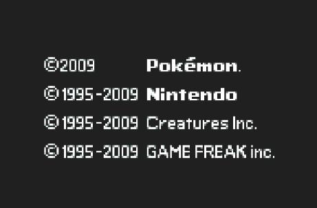

## Human written instructions for: Laying out the opening cutscene in a single screen.
#### Written 21.08.2026 14:40PM

1. Game opens, first text should be from top screen that says 2009 Pokemon, 1995-2009 Nintendo etc  instead of what it currently shows which is the bottom screen ESRB message.
2. Does the spark fade correctly, shows the gamefreak text but as the logo for gamefreak is on the top screen it's missed. It should be shown with the gamefreak text so we can see it all, centered horizontally like the text and the text + logo centered vertically

3. The pokemon logo is shown with the sparkles flying past, thats perfect
4. pokemon logo should fade out and just as it disappears the timing should match with the bottom screen gameplay now showing on the single screen
5. The gameplay sections etc from the bottom screen should play unti it gets to the section with both the male and female characters playing on the top and the bottom screen. From here we need to combine the two on one screen, with the male on top part of the single screen adn the female on the bottom part of it. with them both running.
6. same goes for the clips of them throwing the pokeballs after that
7. Same goes for the pokemon spawning in with the green and red background after that and where it goes through each of the individual pokemon then it does the lightning bolt
8. After the lightning bolt we see cyrus on the bottom screen, he needs to show in the same way the bottom screen shows it on our single screen if he doesn't already.
9. Then we see the Giratine black portal on the brick flooring
10. Then the main menu screen with the logo press start giratina background etc after the fade transition